# Re-blocked: the design

This is the design the plan builds, as agreed. The mockups are in [Mockups.html](Mockups.html); where this file and the mockups disagree, this file wins. Everything Backdrop does today, it still does. What changes is where it lives and how it looks, plus one key: Go to moves from the number keys to G.

Backdrop isn't live yet, so nothing here needs a migration path or a setting to turn it off. Replaced code is deleted.

Pictures of each screen are in [Images/](Images/), shown beside the sections they illustrate. They were rendered from the mockups, so they are drawings: where a picture and the text disagree, the text wins. Today's console, for comparison, is in `AppStore/Screenshots/`.

## 1. Two rooms

- **The Booth** is show mode. It is always dark, whatever the Mac's appearance, in the Booth palette (section 9). With Increase Contrast on, it uses the high-contrast Booth palette.
- **The Studio** is edit mode. It follows the Mac's light or dark appearance and accent colour, as the console does today.
- Both use the same cue list, the **rail** (section 4).
- Changing room is a cross-fade of about 0.3 s. Under Reduce Motion it is instant.
- **Entering the Booth:** one click on **Lock for show** in the Studio toolbar, or Show › Enter Show Mode. The autosave and unused-media prune that happen today still happen first.
- **Leaving the Booth:** press and hold the **Locked for show** pill in the Booth header for 1.0 s. A ring fills while it is held; letting go early does nothing. Show › Enter Edit Mode is unchanged. Neither has a key, as today.
- The Show and Edit switch and the GO button leave the header.

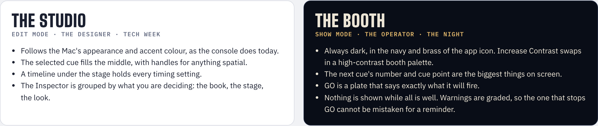

## 2. The Booth

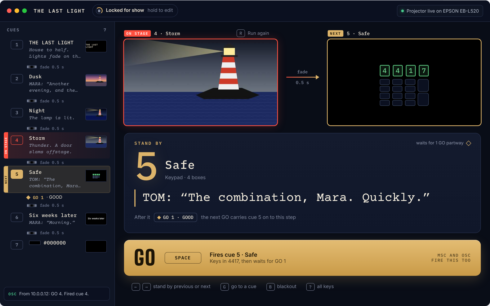

Layout at 1280 × 800, top to bottom: header (56 pt); stop band, only when needed; then the rail on the left and the main column on the right. The main column holds the monitors, the standby card, the GO plate and the key row.

### 2.1 Header

Left to right:
- the show's title in small capitals;
- the lock pill, **Locked for show** with "hold to edit";
- a flexible space;
- any **caution lamps**, only while something needs attention;
- the **projector lamp**.

The projector lamp:
- always shows, with today's lamp text: "Projector live on EPSON EB-L520", "Projector closed" and so on;
- is green when live, amber when the projector has a warning, and grey when closed;
- while blacked out, shows a crossed-out lamp and today's text, "Blacked out — press B";
- opens a menu when clicked: Open or Close Projector, and Choose Projector Display. These are the same items as the Show menu.

Nothing green shows except the projector lamp. **If it doesn't need seeing, it isn't shown.**

There is no Blackout button. B lives in the key row (2.6).

### 2.2 Warnings

Every booth check keeps today's wording, word for word. Each warning gets a tier and a short lamp label.

| Condition | Tier | Lamp label | When |
| --- | --- | --- | --- |
| Another app is in front | Stop | none, the band only | Show mode |
| The console's display is mirrored | Stop | none, the band only | Both modes |
| Overheating, sharply slowed | Stop | none, the band only | Show mode |
| Running hot, slowed | Caution | Hot | Show mode |
| On battery | Caution | Battery 64% | Show mode |
| Low Power Mode | Caution | Low Power | Show mode |
| Show on an external drive | Caution | On SHOW DRIVE | Show mode |
| Show on a server | Caution | On a server | Show mode |
| Projector's display is the main display | Caution | Banners | Both modes |
| Projector standing in on another display | Caution | Stand-in display | Both modes |
| Projector in a window | Caution | In a window | Both modes |
| Projector display disconnected | Caution | Disconnected | Both modes |
| OSC port in use or unavailable | Caution | OSC port | Both modes |

- **A stop** is a red band across the full width under the header. It shows the message, and the label STOP on a white chip. With several, they stack, most urgent first.
- **A caution** is an amber lamp in the header. The most urgent caution's message shows in a one-line amber strip under the header. Clicking any lamp shows its message there instead. When the condition clears, its lamp goes.
- In the Studio, stops show the same band and cautions show as amber lamps beside the projector chip.

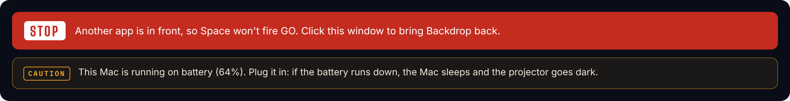

### 2.3 Monitors

- Two monitors of equal size, at the projector's shape, side by side.
- **On stage** is on the left, with a red tally border and the label `ON STAGE  4 · Storm`.
- **Next** is on the right, with a brass tally border and the label `NEXT  5 · Safe`.
- Between them, an arrow from On stage to Next carries the transition GO will run: today's transition note, such as "fade 0.5 s". Where GO carries the live cue on, the arrow reads "carries on".
- **Run again** (R) sits above the On stage monitor, at its right.
- **Blackout:** the On stage picture dims under a slate reading BLACKOUT, "press B to restore".
- **Arming:** while a video or feed standing by is arming, the Next border pulses amber. If it fails, the border is solid amber.
- **End of the sheet:** the Next monitor shows a slate reading "End of the cue sheet" and the arrow goes.
- **Before the first GO:** the Beginners list (2.9) takes the On stage monitor's place.

### 2.4 Standby card

This replaces the standby panel. Top to bottom:

1. **Eyebrow:** STAND BY in brass. At the right, the cue's GO steps as diamonds: filled when taken, solid brass when standing by. Beside them, "waits for 1 GO partway". There are no diamonds for a cue without steps.
2. **Identity:** the cue number in monospaced brass, as large as the room allows, from 72 to 104 pt. Then the name in monospaced type at 30 pt, and under it the kind and today's row summary, such as "Keypad · 4 boxes".
   - A blank shows its colour swatch instead of a name.
   - Clicking the number opens Go To (2.7).
3. **Cue point:** at 33 pt in Courier Prime, behind a brass bar.
   - It wraps to two lines, then truncates, with the full text as a tooltip.
   - With no cue point, today's fallback lines show in italic and dim: "No cue point set", "GO carries cue 5 on to this step.", and so on.
4. **After it:** shown only when there is something to say.
   - For a cue with steps: "After it ◆ GO 1 · GOOD: the next GO carries cue 5 on to this step".
   - For a cue that runs others on: the reach, as in "One GO runs 5, then 6 after 3.0 s".
5. **Arm chip:** for a video or feed, with today's arm texts. Green when armed, pulsing amber while arming, amber when failed.

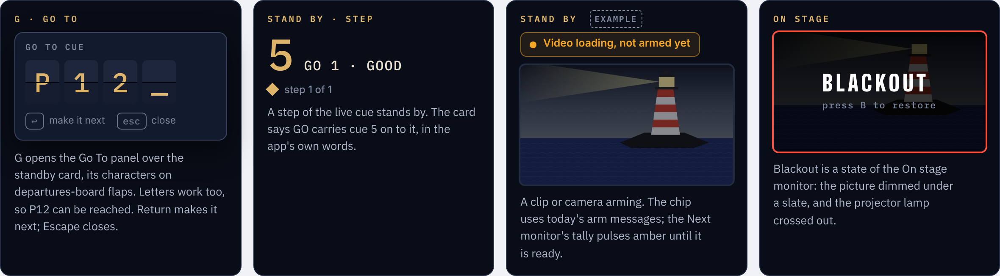

### 2.5 GO plate

- A full-width brass plate. It shows GO in compressed heavy type, a SPACE keycap, and what GO will do in today's wording: "Fire cue 5", "Carry cue 5 on", "Fire cue 6 at GO 2", or "End of the cue sheet", when the plate dims.
- Under that, a second line: either "then waits for GO 1" or the reach (2.4).
- At the right, "MSC and OSC fire this too", only while either is turned on in Settings.
- Clicking it fires GO. It never takes the keyboard.

### 2.6 Key row

A single line under the GO plate:

`← → stand by previous or next  ·  G go to a cue  ·  B blackout  ·  ? all keys`

The Studio has no key row.

### 2.7 Go To

- **Opening:** G opens the Go To panel, in either room and from either window. Pressed in the projector window, it brings the console forward and opens the panel there. Clicking the standby card's number opens it too.
- **Where it appears:** over the standby card in the Booth, and under the stage's header in the Studio.
- **Look:** a GO TO CUE heading, then the typed characters on departures-board flaps with a blinking cursor, then the hints "↩ make it next" and "esc close".
- **Typing:** any printable character except a space, up to 12. Letters are allowed, so P12 works. Delete removes the last one.
- **Return:** stands the cue by, using today's number matching, and closes the panel. If no cue has that number, the panel shows "No cue is numbered P12." under the flaps and stays open.
- **Closing:** Escape, a click outside the panel, or the console losing focus closes it with no change.
- **Space:** fires GO and closes the panel. Holding Space never repeats.
- **Every other key:** while the panel is open, every key without ⌘, ⌃ or ⌥ goes to the panel. B and R type letters there. The arrow keys are swallowed silently, with no beep.
- **Number keys** do nothing by themselves any more, in either room.

### 2.8 Status line

Today's status line, `ShowController.message`, moves to the foot of the rail. Messages from show control and Shortcuts get a source badge (OSC, MSC or SHORTCUT), flash green for 0.6 s, and fade out after 8 s. Every other message stays until something clears it, as today.

### 2.9 Beginners

Shown in the On stage monitor's place in the Booth, from entering show mode until the first cue fires: by GO, a continue, show control or Resume. Each row is green when the check is fine, or shows the warning in amber or red when not.

| Check | Fine | Not fine |
| --- | --- | --- |
| Projector | Projector live on {display} | Today's lamp text and warning. When closed, with an Open Projector button |
| Mirroring | Displays aren't mirrored | Today's warning |
| Backdrop in front | Backdrop is in front: Space fires GO | Today's warning |
| Power | On mains power | Today's warning |
| Heat | Running cool | Today's warning |
| Low Power Mode | Low Power Mode is off | Today's warning |
| Where the show is | Show is on this Mac's internal disk | Today's warning |
| MSC, only while on | MSC listening as device {n} | none |
| OSC, only while on | OSC listening on port {n} | Today's warning |
| Cue sheet | Cue sheet has no issues | {n} issues in the cue sheet, with the messages as a tooltip |
| Next video or feed, only when one stands by | Cue {n} armed | Today's arm text |

Under a REMINDERS · MACOS CAN'T CHECK THESE heading, three reminders with empty circles and nothing stored: "A Focus mode is on", "The projector's wallpaper is black", "Automatic updates are off".

### 2.10 Recovery

This replaces the post-crash alert with a sheet on the console in the Booth look:
- The heading is today's message text, "Backdrop stopped unexpectedly during the show."
- Under it, a picture of the cue finished.
- Then the line "The last cue fired was **cue 4 · Storm**, at 21:14. Resuming puts it straight back on the projector, finished, with the cue after it up next." The time comes from `CrashRecord.firedAt`.
- The buttons are **Resume at Cue 4** (brass, the default, Return) and **Start from the Top**. They do exactly what today's buttons do.

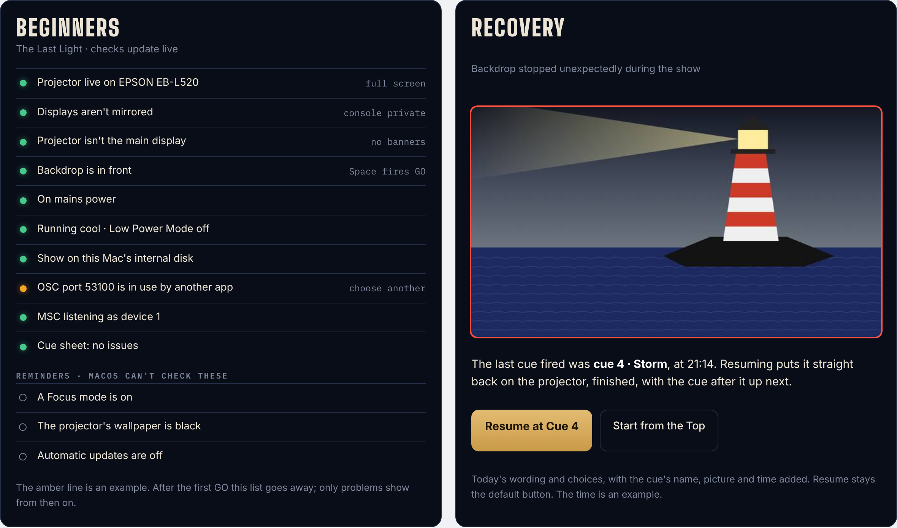

## 3. Keys

| Key | Does | Change |
| --- | --- | --- |
| Space | Fires GO. Also while the Go To panel is open | Same |
| → ↓ Page Down, ← ↑ Page Up | Stand by the next or previous row | Same |
| G | Opens Go To | New |
| R | Run again | Same |
| B | Blackout | Same |
| ? | Shows every key, over the window; Escape or ? closes it | New |
| 0–9, `.`, Return, Escape, Delete | Nothing outside the Go To panel | Removed |

Every plain key is still swallowed so the Mac never beeps, and held keys still never repeat.

## 4. The rail

The same component in both rooms, drawn in each room's palette.

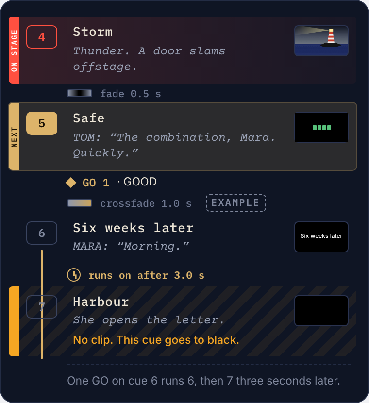

### 4.1 A row

- **Margin box:** the cue number in a 32 × 22 pt box with a 1.5 pt border and 5 pt corners, as pencilled in the book.
  - Next: a filled brass box with dark text.
  - On stage: a red border and red text.
- **Name:** monospaced, 13 pt.
- **Cue point:** Courier Prime italic, 12.5 pt. Two lines in the Booth, one in the Studio.
- **Summary:** the Studio shows today's summary line, such as "4 boxes" or "no picture", between the name and the cue point. The Booth doesn't.
- **Thumbnail:** 56 × 32 pt at the right, showing the cue finished. Video shows its first frame, a feed a camera glyph, and a blank its colour.
- **Left tab:** the square tab the app draws today, `Desk.drawTab`, with the label reading up it. NEXT is brass and ON STAGE is red. A row with an issue gets an amber tab with no label.
- **Corners:** rows have 4 pt corners.
- **Issues:** an issue row has an amber hatch, plus the issue's message under the cue point in amber, from `Show.message(for:)`.

### 4.2 Between rows

- **Joins:** shown in both rooms, between every pair of cues. A 26 × 8 pt glyph for the transition style, then today's note: "fade 0.5 s", "crossfade 1.0 s", "wipe from left 0.5 s" or "snap".

  | Style | Glyph |
  | --- | --- |
  | Snap | Hard split |
  | Fade | Grey to black to grey |
  | Crossfade | Blend |
  | Wipe | Slanted split |

  In the Studio a join is clickable and selects the transition, and right-click clears it, as transition rows do today. In the Booth joins are not clickable.
- **Links:** when a cue continues by itself, a 2 pt brass spine joins its margin box to the next one's. The label reads "runs on after 3.0 s", "runs on when finished", or "runs on 2.0 s after finishing". A cue that waits for GO has no spine. This is a refinement of the mockups, which show a broken line: nothing is drawn because nothing needs seeing.
- **Reach:** in the Booth, under the last row of the chain that starts at the standby cue, one dim line, such as "One GO on cue 6 runs 6, then 7 three seconds later."

### 4.3 Other parts of the rail

- **GO steps:** stay as rows under their cue: a diamond, "GO 1", then the step's text and cue point. Taken steps are ticked and dim; the step standing by is brass.
- **Studio hover:** delete and the grip show only while the pointer is over a row. Over the gap between rows, a brass **+** appears, which opens the cue gallery to add a cue there.
- **Dropping media:** while files are dragged over the rail, a 28 pt slot opens where they would land, labelled "Drop to add 3 cues here", and the rows below move down. A row that would take a single picture or clip outlines in brass and says "Use this picture" or "Use this clip".
- **Status line:** at the foot of the rail (2.8).

## 5. The cue gallery

This replaces the Add Cue sheet. It is 760 × 600.

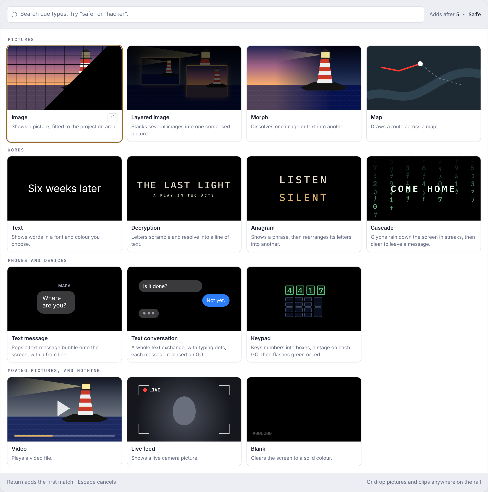

- **Search:** the field is focused when the sheet opens, with the placeholder "Search cue types. Try “safe” or “hacker”." Matching is today's `Cue.Kind.matching`. Return adds the first match, which is outlined, and Escape cancels.
- **Position:** the top right says where the cue will go: "Adds after **5 · Safe**", "Adds at the end", or "Starts the sheet".
- **Groups, with an empty search:**

  | Group | Kinds |
  | --- | --- |
  | Pictures | Image, Layered image, Morph, Map |
  | Words | Text, Decryption, Anagram, Cascade |
  | Phones and devices | Text message, Text conversation, Keypad |
  | Moving pictures, and nothing | Video, Live feed, Blank |

  With a search, the matches show in rank order with no groups.
- **Cards:** a 16:9 preview, the kind's heading and today's blurb, word for word.
- **Previews:** each one loops: the kind's sample cue (Plan 4.2) runs from the start, rests finished for 1.5 s, and runs again.
  - Video shows a still poster with a play mark, and Live feed a camera graphic. Neither opens a file or the camera.
  - Only cards on screen run. Under Reduce Motion, each shows its finished frame.
- **Footer:** "Return adds the first match · Escape cancels" and "Or drop pictures and clips anywhere on the rail".

## 6. The Studio

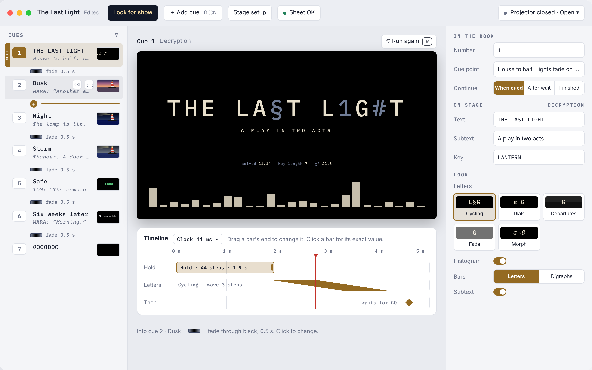

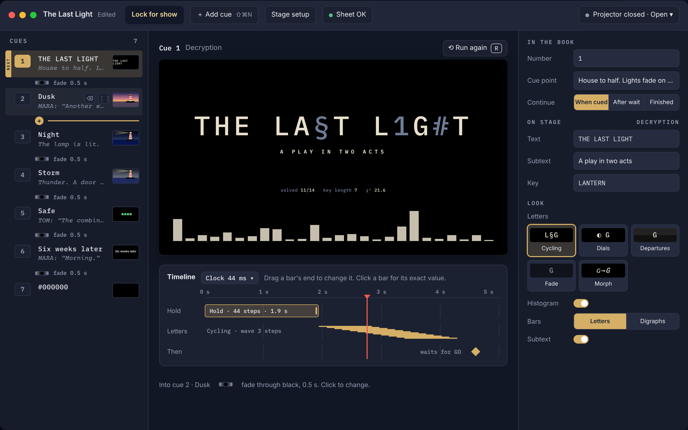

### 6.1 Toolbar

Left to right:
- the title, with the document's edited state;
- **Lock for show** (primary);
- **Add cue** (⇧⌘N);
- **Stage setup**, a toggle that replaces Show Settings;
- the **sheet health** badge;
- a flexible space;
- any caution lamps;
- the **projector chip**: a small live picture of what the projector shows, the lamp text, and the same menu as the Booth's lamp.

The sheet health badge reads "Sheet OK" in green with no issues, or "{n} issues" in amber. Clicking it opens a popover listing every issue's message, each with a button that stands its cue by.

### 6.2 Stage

- The middle shows the selected cue as large as the window allows, at the projector's shape.
- Above it: "Cue 1 · Decryption" at the left, and **Run again** (R) at the right.
- Below it: the timeline (6.5), then the "Into cue 2 · Dusk" join line, which can be clicked to edit that transition.
- **No cues:** the stage shows the **bare stage**: the icon's model box in perspective, with the wordmark decrypting on its back wall. Under it, "Drop pictures and clips onto the stage, or add a cue." and an Add cue button. Files dropped on it start the sheet.
- **Cues, but none selected:** the stage shows the wordmark, as today.

### 6.3 Inspector

Three groups:

| Group | Holds |
| --- | --- |
| In the book | Number, Cue point (or the GO step's cue point), Continue and its seconds, and **Steps** (today's Advance setting, renamed, for kinds that have it) |
| On stage | Today's content section for the kind: text, wells, layer strip, morph pictures, route summary and so on |
| Look | Every setting of the kind that isn't timing. Choices with a visible result are picture chips |

These choices become picture chips: Letters, Order, Reveal, Camera, Others while it arrives, Frame, and Entrance, which is toggle chips. Bars is a segmented control. The rest stay as today's controls. Each chip's picture is the kind's own renderer, drawn offscreen at a telling frame with that option.

Timing settings leave the Inspector for the timeline: Wave, Hold, Pause, Morph, Layer, Flip, Frame move, Lasts and Fade. Clock stays as the timeline's tempo menu. Each setting's help text moves with it, to the timeline's popover.

### 6.4 Transitions

Clicking a join in the rail, or the line under the timeline, selects that cue's transition. The Inspector then shows the transition's style and Wipe from, and the timeline's In bar is highlighted. Its length is that bar.

### 6.5 Timeline

- **Ruler:** in seconds, starting when the cue fires. The cue's clock appears at the left as "Clock 44 ms ▾", a menu.
- **Tracks:** from top to bottom, only those the kind has.
  - **In:** the transition's style and length. Not shown for the first cue.
  - **Hold.**
  - **The kind's own tracks:** see the table below.
  - **GO steps:** a diamond at each step, and a hatched area after it, because everything after a diamond waits for the operator.
  - **Then:** a diamond "waits for GO" for a cue that waits, or a bar for a timed continue, whose end edits its seconds.
- **Dragging:** a handle drags to a whole step of the clock, within the setting's range. A drag is one undo step, merged as slider drags are today.
- **Clicking:** a bar opens a popover with that setting's exact control, value and help text.
- **Playhead:** while Run again plays, a red playhead sweeps the ruler.
- **Keyboard and VoiceOver:** each handle is an adjustable element. The arrow keys move it one step, and VoiceOver reads its name, value and seconds.

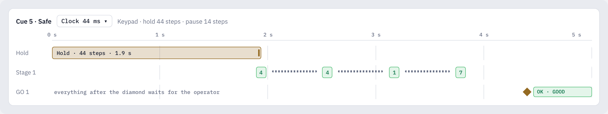

| Kind | Its own tracks | What drags |
| --- | --- | --- |
| Decryption | Letters: a bar per character, from each character's travel plan | Hold; the fan's slope is Wave |
| Anagram | Each anagram's working, part by part, with pauses | Hold; Wave; Pause gaps |
| Image | Tiles, to when the last tile settles | Hold; Wave; the bar's end is Flip |
| Morph | A bar per stage | Hold; a stage's end is Morph, or that picture's own; Pause gaps |
| Map | A bar per leg | Hold; Pause gaps |
| Layered image | A bar per layer arriving, and frame moves | Hold; a layer's end is Layer, or its own; a move's end is Frame move; Pause gaps |
| Keypad | A tick per key press, and the verdict flash | Hold; Pause gaps |
| Cascade | Rain, then the message | Hold |
| Text conversation | A tick per message | The conversation's pause |
| Text message | The entrance | The entrance time |
| Video | The clip's length | Nothing |
| Text, Blank, Live feed | Nothing of their own | Nothing |

### 6.6 Stage setup

With Stage setup on:
- The stage shows the whole projector output with the projection area outlined in brass, with eight handles and a readout: "W 62% · H 62% · across +10% · down −3%".
- Dragging an edge or corner resizes the area. Dragging inside it moves it. Moves snap to the centre lines within 1%.
- The Inspector shows today's Show Settings: title, text size, shape, the four numbers, alignment guides, and Fill the Output.

### 6.7 Focus modes

- **Morph points:** Edit Points… in the Inspector turns the stage into the morph points editor. It has the two pictures, the paired points and the stage chooser, and the timeline area becomes the morph scrubber. Find Faces, Clear All, Delete and undo work as in today's window. Done, or Escape, returns to the stage. The separate window goes.
- **Map route:** Edit Route… does the same with today's route editor and its inspector. The separate window goes.

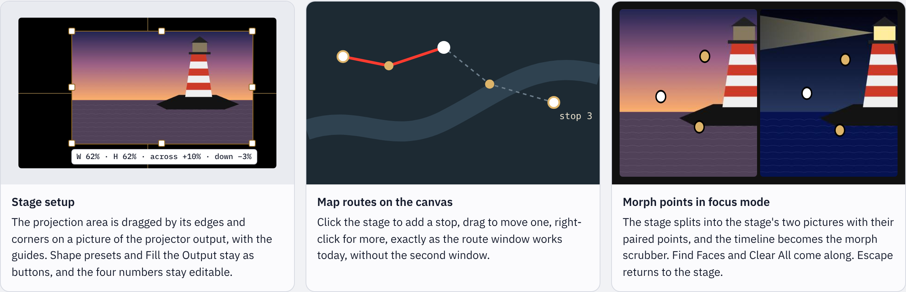

### 6.8 Storyboard

A List | Storyboard switch at the top of the rail. Storyboard replaces the stage with a grid of every cue's finished frame, labelled with its number. Clicking a frame selects that cue, and double-clicking returns to the stage with it selected.

### 6.9 Smaller pieces, in pictures

The lock, key help, Go To flaps, projector chip, status line, sheet health, bare stage, storyboard and dropping media. The sheet health issues shown are invented examples.

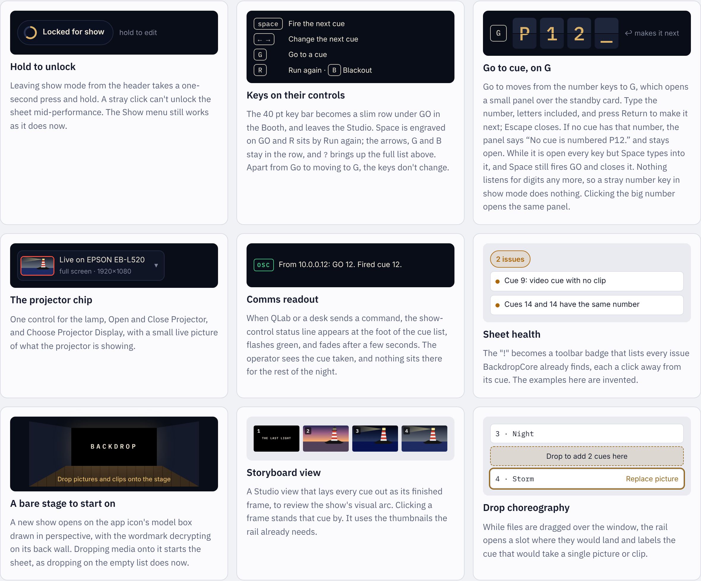

## 7. Unchanged

These stay as they are:
- the Settings window;
- MSC and OSC behaviour;
- Shortcuts and Spotlight;
- Quick Look;
- printing and Export Cue Sheet as PDF;
- the menus, except that a menu item is relabelled where its target was renamed (Show Settings… becomes Stage Setup…);
- undo, and every rule about edit mode only;
- the projector window;
- the `.backdrop` format;
- every renderer's output.

## 8. Words

Reuse today's strings wherever they exist. Every string that is new in this design appears above, in quotes. Spelling is British, as in the rest of the app.

## 9. Palette and type

The Booth palette is fixed. The Studio uses today's `Desk` system colours.

| Token | Booth | Booth, Increase Contrast |
| --- | --- | --- |
| background | #090D17 | #000000 |
| panel | #0F1524 | #0B0F1A |
| raised | #161E33 | #1A2238 |
| line | #232C44 | #5A6684 |
| ink | #ECE5D6 | #FFFFFF |
| dim | #7F879C | #B8BFCE |
| brass (next, GO) | #DDB46A | #F2CC80 |
| tally (on stage, stop) | #FF5040 | #FF6A5C |
| ok | #47C98B | #5FE0A0 |
| amber (caution) | #F5A623 | #FFBE45 |

| Use | Type |
| --- | --- |
| Interface | System font |
| Cue names and numbers | System monospaced |
| GO | System font, black weight, compressed width |
| Cue points | Courier Prime, bundled under the SIL Open Font License |
